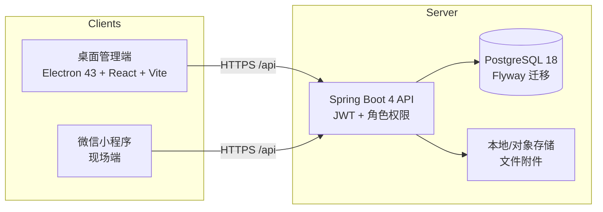

# LaborFlow

建筑劳务经营与薪酬管理平台 v0.1 MVP，当前聚焦员工信息管理与工资发放管理。

## 技术栈

- Desktop：Electron 43、React 19、React Router、TypeScript、Vite、TanStack Query、ECharts、Axios
- Miniapp：Taro 4 API、React 19、Tailwind CSS 4、weapp-tailwindcss、Taroify、TypeScript
- Server：Spring Boot 4、Java 21、MyBatis Plus、Spring Security、JWT、Flyway、PostgreSQL 18、OpenAPI

## 前置依赖

| 工具 | 版本要求 | 说明 |
|---|---|---|
| JDK | 21 | 后端编译与运行；通过 `JAVA_HOME` 或 PATH 提供 |
| Maven | 3.6.3+ | 后端构建；通过 `MAVEN_BIN` 或 PATH 提供 |
| Bun | 1.3.14 | 根启动器、两个活跃客户端的依赖安装、脚本、检查与构建 |
| Electron 内置 Node | 随 Electron 43 提供 | 仅 Electron 应用运行时使用，无需单独安装系统 Node.js；Miniapp 不需要 Node |
| 平台构建工具 | 当前操作系统对应版本 | Electron Forge 在目标系统生成安装包；签名工具和 Linux 打包工具按发行格式安装 |
| Docker | 任意现代版本 | 本地 PostgreSQL（`deploy/docker-laborflow`）；后端集成测试用 Testcontainers |
| 微信开发者工具 | 稳定版 | 仅小程序本地开发/真机调试需要 |

版本与验证顺序以各本地质量门文档（`docs/CI_*_GATE.md`）为准。

## 架构



- 三端共享同一套 Spring Boot API 与 JWT；角色决定可见范围。
- 桌面端与小程序都是 API 的纯客户端，无独立业务后端；Electron 仅通过受限 preload/IPC 提供桌面能力。
- 数据库结构由 Flyway 管理（`server/src/main/resources/db/migration`），新表/新列时间列一律 `TIMESTAMP WITH TIME ZONE`（见 [`docs/TIMEZONE_POLICY.md`](docs/TIMEZONE_POLICY.md)）。

## 本地启动

```bash
cp .env.example .env
docker compose up -d
```

PostgreSQL 默认映射到宿主机 `5434` 端口，后端默认连接 `jdbc:postgresql://localhost:5434/laborflow`。

默认服务端口：桌面渲染层开发端口 `5175`，后端 `8089`。

一键启动本地 PostgreSQL、后端、桌面端和小程序 watch：

```bash
bun run.ts
```

后端需要 Java 21 和 Maven（通过 `JAVA_HOME` 或 PATH 提供）：

```bash
cd server
mvn spring-boot:run
```

桌面端：

```bash
cd clients/desktop
bun install --frozen-lockfile
bun run dev
```

平台安装包使用构建时 API 地址生成：

```bash
cd clients/desktop
VITE_API_BASE_URL=https://api.example.com/api bun run build
```

构建产物位于 `clients/desktop/out/make/`。Windows、macOS、Linux
安装包应在对应操作系统的构建机上生成并完成代码签名。

小程序：

```bash
cd clients/miniapp
bun install --frozen-lockfile
bun run dev
# 微信开发者工具导入 clients/miniapp/dist/
```

需要正式微信 App ID 时，先将 `clients/miniapp/.env.example` 复制为不会提交的
`.env.local` 并填写；未配置时使用 `touristappid`。原生版本保留在
`legacy/miniapp/`，仅用于迁移期间对照。

生产环境不提供可直接登录的默认账号。首次管理员必须通过下方受控的启动期初始化流程
创建，不应通过自助注册、公开接口或手工修改前端来绕过权限边界。

## 正式版验收资料

当前正式上线范围、明确延期项和非部署 Gate 条件见
[`docs/LAUNCH_SCOPE.md`](docs/LAUNCH_SCOPE.md)。实际验收、签字和 Gate 结论见
[`docs/UAT_SIGNOFF.md`](docs/UAT_SIGNOFF.md) 与
[`docs/LAUNCH_READINESS_REVIEW.md`](docs/LAUNCH_READINESS_REVIEW.md)，它们不应被代码存在
与自动化通过所替代。

- 桌面管理端角色路径见 [`docs/USER_GUIDE_DESKTOP.md`](docs/USER_GUIDE_DESKTOP.md)。
- 小程序现场端角色路径见 [`docs/USER_GUIDE_MINIAPP.md`](docs/USER_GUIDE_MINIAPP.md)。
- 缺陷分级、阻断与延期批准要求见
  [`docs/LAUNCH_DEFECT_POLICY.md`](docs/LAUNCH_DEFECT_POLICY.md)。
- 业务 UAT 场景与证据要求见 [`docs/UAT_CHECKLIST.md`](docs/UAT_CHECKLIST.md) 和
  [`docs/REGRESSION_EVIDENCE_POLICY.md`](docs/REGRESSION_EVIDENCE_POLICY.md)。
- 当前非部署 Gate 结论和阻断项见
  [`docs/LAUNCH_READINESS_REVIEW.md`](docs/LAUNCH_READINESS_REVIEW.md) 与
  [`docs/UAT_SIGNOFF.md`](docs/UAT_SIGNOFF.md)；当前结论为“不批准”，不是上线通过声明。

这些资料只使用测试或脱敏数据；不得在仓库、截图或验收记录中写入密码、token、真实
个人信息或生产数据。

## 首次管理员初始化

Flyway 会创建默认角色和一个已停用的历史管理员账号，但不会提供可登录的默认密码。
当数据库没有启用的 `ADMIN` 用户时，服务启动会拒绝继续运行，直到通过运行环境同时提供
下列一次性配置：

```text
BOOTSTRAP_ADMIN_USERNAME=<3-64 个字符的管理员账号>
BOOTSTRAP_ADMIN_PASSWORD=<12-64 个字符的管理员密码>
```

启动期只会在不存在启用的 `ADMIN` 时创建管理员，或恢复同名且已有 `ADMIN` 角色的停用
账号；它不会提升同名普通账号。密码只会 BCrypt 加密入库，且不会写入日志。首次管理员
登录并创建日常账号后，应从运行环境移除这两个配置并重启一次确认不会再次执行。

完整的角色、工资项、工序库、测试账号和微信绑定准备步骤见
[`docs/INITIALIZATION_CHECKLIST.md`](docs/INITIALIZATION_CHECKLIST.md)。

## 后端集成测试

后端的 `mvn test` 会运行单元测试以及 PostgreSQL 集成测试。集成测试使用 Testcontainers
启动一次短生命周期的 PostgreSQL 18，自动执行 Flyway，并验证管理员登录和受保护接口；
运行该命令的本机或 CI runner 需要可访问 Docker。

```bash
cd server
mvn test
```

The local backend gate and its Docker/Testcontainers requirement are documented
in [`docs/CI_BACKEND_GATE.md`](docs/CI_BACKEND_GATE.md).
The desktop renderer typecheck, test, and build gate is documented in
[`docs/CI_DESKTOP_GATE.md`](docs/CI_DESKTOP_GATE.md).
The active miniapp Bun build gate and manual smoke evidence template are documented in
[`docs/CI_MINIAPP_GATE.md`](docs/CI_MINIAPP_GATE.md).
The documentation, Flyway migration, and whitespace gate is documented in
[`docs/CI_DOCS_GATE.md`](docs/CI_DOCS_GATE.md).
The required pull-request regression evidence and review rule for payroll,
projects, permissions, and migrations is documented in
[`docs/REGRESSION_EVIDENCE_POLICY.md`](docs/REGRESSION_EVIDENCE_POLICY.md).
The automated payroll lifecycle regression and accompanying desktop smoke record
are documented in [`docs/PAYROLL_E2E_REGRESSION.md`](docs/PAYROLL_E2E_REGRESSION.md).
The project daily-report, team-settlement, payment, and dashboard regression is
documented in [`docs/PROJECT_SETTLEMENT_E2E_REGRESSION.md`](docs/PROJECT_SETTLEMENT_E2E_REGRESSION.md).
The variation-order attachment, commercial confirmation, and project-income
regression is documented in
[`docs/VARIATION_INCOME_E2E_REGRESSION.md`](docs/VARIATION_INCOME_E2E_REGRESSION.md).
The attendance, statutory-deduction, performance, and project-bonus payroll
source regression is documented in
[`docs/SALARY_SOURCES_E2E_REGRESSION.md`](docs/SALARY_SOURCES_E2E_REGRESSION.md).
The authorization, salary-scope, project-scope, sensitive-user-field, and desktop
no-permission regression is documented in
[`docs/ACCESS_CONTROL_E2E_REGRESSION.md`](docs/ACCESS_CONTROL_E2E_REGRESSION.md).
The cross-module operation-log regression and administrator smoke record are
documented in [`docs/AUDIT_LOG_E2E_REGRESSION.md`](docs/AUDIT_LOG_E2E_REGRESSION.md).
The private-file download and cross-business attachment-boundary regression is
documented in [`docs/FILE_ACCESS_E2E_REGRESSION.md`](docs/FILE_ACCESS_E2E_REGRESSION.md).


## 目录

```text
clients/desktop/  Electron 43 + React 桌面管理端
clients/miniapp/  Taro + React 19 微信小程序端
server/   Spring Boot API 服务
legacy/miniapp/  原生微信小程序端（legacy，迁移对照）
deploy/   docker-compose（本地 PostgreSQL）
scripts/  CI 与构建辅助脚本
docs/     产品、工程、CI、回归、验收文档（索引见 docs/INDEX.md）
```

完整的文档分类与导航见 [`docs/INDEX.md`](docs/INDEX.md)。
